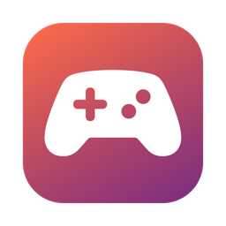

<div align="center">



# Couch

**Your gamepad, now a media remote for your Mac.**
Lean back, thumbs on the pad. Works with IINA, YouTube and any player that
listens to media keys.

[](https://github.com/necromancerthedark/Couch/releases/latest)


[Install](#-install) ·
[Controls](#-controls) ·
[Accessibility](#-first-run-accessibility) ·
[Tuning](#-tuning-without-a-rebuild) ·
[Troubleshooting](#-troubleshooting)

</div>

---

## ✨ What it does

- 🎮 **Fixed, sensible mapping.** Play/pause, seek, volume, next/prev, mute,
  fullscreen, brightness. No setup, no rebind screen.
- 🎚️ **Analog scrubbing.** Hold a trigger to seek. Press deeper to scrub faster.
- 🫥 **Menu-bar only.** No Dock icon. A filled icon means the pad is live.
- 🔌 **Reconnects by itself.** The pad sleeps when idle. Wake it with the Xbox
  button and Couch picks it back up.
- 🚫 **No cursor control.** Keys and media keys only, by design.

Built and tested with an Xbox-protocol pad (Cosmic Byte Blitz) on macOS 26.
Input uses Apple's GameController framework, so other pads that macOS maps to
an extended gamepad should work too.

## 🎮 Controls

```
   ┌──────── LT ────────┐          ┌──────── RT ────────┐
   │ scrub back         │          │ scrub forward      │
   ├──────── LB ────────┤          ├──────── RB ────────┤
   │ brightness down    │          │ brightness up      │
   └────────────────────┘          └────────────────────┘

   D-pad:  ▲ system volume up                ( Y )  fullscreen
           ◄ seek   seek ►     [Menu] mute    ( X )  previous    ( B )  next
           ▼ system volume down                ( A )  play / pause

   Left stick:  ▲ player volume up   ▼ player volume down
```

| Pad input | Action | Sent as |
|---|---|---|
| **A** | Play / pause | media key |
| **B** | Next track | media key |
| **X** | Previous track | media key |
| **Y** | Toggle fullscreen | `F` key (IINA, YouTube) |
| **Menu** | Mute | media key |
| **D-pad ◄ ►** | Seek back / forward | arrow keys |
| **D-pad ▲ ▼** | System volume up / down, one notch per press | media key |
| **Left stick ▲ ▼** | Player volume up / down. Hold to repeat, push further to go faster | arrow keys, repeating |
| **LB / RB** | Brightness down / up | media key |
| **LT / RT** | Hold to scrub back / forward | arrow keys, repeating |

> Brightness controls the system display. It may do nothing on an external
> monitor.

### The menu

| Item | What it does |
|---|---|
| Controller line | Shows the connected pad, or "No controller" |
| **Remote** switch | Turns the whole pad on or off without quitting |
| **Launch at Login** switch | Starts Couch when you log in |
| Check Accessibility… | Re-prompts for the permission |
| About Couch | Version and credits |

## 📦 Install

1. Download `Couch-v0.x.zip` from the
   [latest release](https://github.com/necromancerthedark/Couch/releases/latest)
   and unzip it.
2. Move `Couch.app` to `/Applications`.
3. The app is signed with a local certificate and is **not notarized**, so
   Gatekeeper blocks the first launch. Right-click the app → **Open** → **Open**,
   or run:

   ```sh
   xattr -dr com.apple.quarantine /Applications/Couch.app
   ```

4. Grant Accessibility (next section).

Apple silicon only (arm64).

## 🔐 First run: Accessibility

Posting key events needs the Accessibility permission. Reading the pad does not.

1. System Settings → Privacy & Security → **Accessibility**.
2. Add `Couch.app` and turn it on.
3. **Quit and relaunch Couch.** A process started before the grant does not get it.

<details>
<summary><b>Building from source</b></summary>

<br>

Needs macOS 13+ and Swift 5.9+. Command Line Tools are enough, Xcode is not
required.

```sh
./Scripts/build-app.sh        # builds and signs dist/Couch.app
./Scripts/build-app.sh run    # same, then launches it
./Scripts/grant-accessibility.sh   # opens the pane and reveals the app
```

**Keep the grant across rebuilds.** An ad-hoc signature changes on every build,
which drops the Accessibility grant. Run this once to create a local
self-signed identity ("Couch Local Signing") in your login keychain:

```sh
./Scripts/setup-signing.sh    # asks for your password once
```

`build-app.sh` then signs with it automatically and the grant survives
rebuilds. Grant Accessibility once more after the first build with the new
identity. Without it, builds fall back to ad-hoc and you must re-grant after
each one. Remove the certificate later in Keychain Access.

</details>

## 🔧 Tuning without a rebuild

Optional file `~/Library/Application Support/Couch/config.json`:

```json
{ "triggerThreshold": 0.15, "seekSlow": 0.5, "seekFast": 0.08,
  "stickDeadzone": 0.30, "volumeSlow": 0.30, "volumeFast": 0.08 }
```

| Key | Meaning | Allowed |
|---|---|---|
| `triggerThreshold` | How far a trigger must be pressed to count | 0.01 – 0.95 |
| `seekSlow` | Seconds between seeks at a light press | `seekFast` – 5 |
| `seekFast` | Seconds between seeks at a full press | 0.02 – `seekSlow` |
| `stickDeadzone` | How far the left stick must be pushed to change volume | 0.1 – 0.9 |
| `volumeSlow` | Seconds between volume steps just past the deadzone | `volumeFast` – 5 |
| `volumeFast` | Seconds between volume steps at a full push | 0.02 – `volumeSlow` |

Invalid values are logged and replaced by the defaults.

## 🩺 Troubleshooting

<details>
<summary><b>Nothing happens when I press buttons</b></summary>

<br>

- Check the menu: the controller line should name your pad, and **Remote**
  should be on.
- Check **Accessibility**: the log line `accessibility: trusted=true` must be
  there. If it says `false`, redo the grant and relaunch.
- The pad sleeps after about 5 minutes idle. Press the Xbox button to wake it.

</details>

<details>
<summary><b>Where is the log?</b></summary>

<br>

`~/Library/Logs/Couch.log`. It is reset at each launch, capped at 1 MB, and
records the Accessibility state, pad attach and detach, and each input and
action.

</details>

<details>
<summary><b>Why does it need background input?</b></summary>

<br>

GameController only delivers input to the frontmost app. A menu-bar app is
never frontmost, so Couch sets `GCController.shouldMonitorBackgroundEvents`
(see ADR-013).

</details>

## 📁 Project layout

```
Sources/Couch/      menu-bar app (input, mapping, output, menu)
Sources/pad-dump/   CLI that prints live pad state, for debugging
Scripts/            build, signing, Accessibility helper, icon generator
Resources/          Info.plist, app icon
PLAN.md · ADR.md    roadmap and decision records
```

---

<div align="center">

Made by [Kumar Gaurav Pandey](https://github.com/necromancerthedark)

</div>
